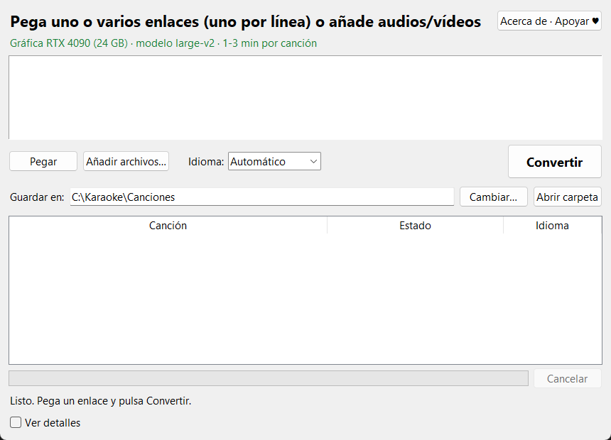

# Karaokiza

**Convierte una canción en un karaoke para [UltraStar](https://usdx.eu/) pegando un enlace.**
Descarga el vídeo, detecta el idioma, separa la voz de la música, escribe la letra con sus tiempos
y saca las notas. Todo en tu ordenador, sin cuentas y sin enviar datos a nadie.

*English: Karaokiza turns a YouTube link or an audio file into a ready-to-sing UltraStar karaoke
song (language detection, vocal separation, lyrics, timing and notes), all locally on Windows.*



## Descarga

Instalador para Windows 10/11: **[Releases](https://github.com/vicsaizo/Karaokiza/releases/latest)**
o en [itch.io](https://vicsaizo.itch.io/karaokiza) (paga lo que quieras, también gratis).

1. Ejecuta `Karaokiza-Setup-x.y.z.exe` (no necesita administrador).
2. La primera vez pide instalar el motor de conversión: descarga Python, las librerías, ffmpeg y los
   modelos de IA (unos 4,5 GB sin gráfica NVIDIA, más con ella). Solo se hace una vez.
3. Pega un enlace de YouTube y pulsa **Convertir**. Las canciones quedan en
   `C:\Users\<tú>\Karaokiza\Canciones`, listas para añadir como carpeta de canciones en UltraStar.

> Windows puede avisar «Windows protegió su PC» porque el instalador aún no está firmado:
> *Más información → Ejecutar de todas formas*.

## Rendimiento

| Equipo | Por canción (3-4 min) |
|---|---|
| Gráfica NVIDIA (probado con RTX 4090) | 1-3 min |
| Sin gráfica NVIDIA (portátil sencillo) | 15-25 min (estimado), con modelo más ligero |

Sin gráfica NVIDIA funciona en modo CPU. Con 8 GB de RAM, cierra el navegador mientras convierte.

## Qué hace distinto a UltraSinger

Karaokiza es una ventana sobre [UltraSinger](https://github.com/rakuri255/UltraSinger) (Vadim Rangnau,
MIT), fijado en el commit de `patches/UPSTREAM_COMMIT.txt`, más estos parches y mejoras:

- Nombres fiables: solo se renombra con MusicBrainz si artista **y** título coinciden; se limpian
  «(Official Video)», emojis y coletillas.
- Idioma detectado votando en los 5 fragmentos con más voz, no solo en los primeros 30 s.
- Audio en mp3 y vídeo H.264 ≤1080p (lo que UltraStar reproduce sin problemas).
- yt-dlp se actualiza solo cada pocos días, porque YouTube cambia a menudo.
- Arregla un fallo al crear el MIDI con notas de duración cero.
- Instalación autónoma: Python, librerías, ffmpeg y modelos, con elección de modelo según la gráfica y la RAM.

## Compilar desde el código

Requisitos: Windows, `git`, [`uv`](https://docs.astral.sh/uv/) e Inno Setup 6.

```powershell
winget install astral-sh.uv JRSoftware.InnoSetup
powershell -File tools\build.ps1
```

Genera `dist\Karaokiza-Setup-<versión>.exe`. El script clona UltraSinger en el commit fijado, aplica
`patches\*.patch`, empaqueta la ventana con PyInstaller y compila el instalador.

## Aviso: no es 100 % preciso

Karaokiza trabaja con modelos de IA y el resultado es automático: la letra, los tiempos y las notas
pueden tener errores (palabras mal escuchadas, notas desplazadas, idioma mal detectado, nombres de
canción incorrectos). Revisa cada canción y corrígela en el editor de UltraStar si hace falta.
Se ofrece «tal cual», sin garantías.

*English: Karaokiza uses AI models and its output is automatic and not 100% accurate. Lyrics, timing,
notes, detected language and song names may contain mistakes. Please review each song and fix it in the
UltraStar editor if needed. Provided "as is", without warranty.*

## Privacidad y uso responsable

- No recoge ni envía datos tuyos. Solo consulta GitHub para saber si hay una versión nueva (se puede
  desactivar en *Acerca de*) y descarga canciones, modelos y programas de sus webs oficiales.
- Úsalo con contenido que tengas derecho a usar. Descargar de YouTube puede ir contra sus condiciones
  de uso; tú eres responsable de lo que conviertes.

## Apoyar el proyecto

Es gratis. Si te ha sido útil: [Ko-fi](https://ko-fi.com/vicsaizo) ·
[itch.io](https://vicsaizo.itch.io/karaokiza). Fallos y sugerencias: abre un
[issue](https://github.com/vicsaizo/Karaokiza/issues) o escribe a vicsaizo@vicsaizo.com.

## Licencia

MIT. Componentes de terceros y sus licencias: [LICENCIAS.txt](LICENCIAS.txt).
